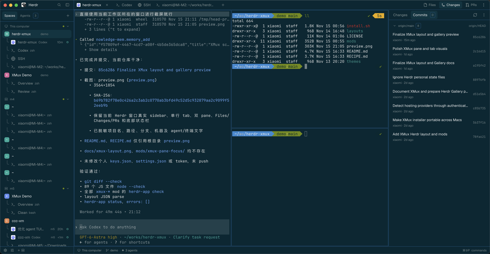

# XMux

XMux is a compact, terminal-first Herdr layout and mod set for working across
spaces, coding agents, split panes, and repository panels.



A Ghostty-inspired Herdr workspace with compact tabs, split panes, and Files,
Changes, PRs, and Issues panels.

## Features

- A single 36px tab row with horizontal scrolling and truncated titles.
- Same-space tab dragging, machine ordering, and space and agent navigation.
- `+` starts a terminal in the active pane's directory; Shift-click opens the
  terminal and agent picker. `Cmd+Ctrl+T` opens the same picker.
- `Cmd+Shift+T` starts a fresh terminal in the most recently closed tab's
  directory, at its previous position. It does not resume the old process.
- `` Cmd+` `` toggles a draggable local terminal over XMux. Hiding keeps the
  shell running; closing it or exiting the shell removes the window.
- Files, Changes, PRs, and Issues panels with repository-aware actions.
- One-pixel pane frames, split spacing, focus treatment, and continuous shell
  boundaries.
- A Ghostty Solarized Dark theme shared by the Herdr chrome and terminals.
- GitHub and GitLab provider detection based on the repository remote and the
  locally authenticated `gh` or `glab` CLI.

## Included files

| Path | Purpose |
| --- | --- |
| `layouts/XMux.json` | The XMux window layout. |
| `themes/ghostty-solarized-dark.json` | Shared terminal and app theme. |
| `mods/xmux-tabs` | Tabs, scrolling, titles, and panel actions. |
| `mods/xmux-sidebar` | Window chrome, spaces, agents, machines, and quick actions. |
| `mods/xmux-files` | File tree and file viewer. |
| `mods/xmux-changes` | Changes, staging, commits, and diffs. |
| `mods/xmux-branch-pr` | Pull request workflow. |
| `mods/xmux-branch-issue` | Issue workflow. |
| `mods/xmux-new-menu` | Terminal and agent creation menu. |
| `mods/xmux-quick-dialog` | Floating local terminal title bar and controls. |
| `mods/xmux-status` | Bottom status bar and XMux commands. |

Herdr supplies the remaining workspace pieces, including its built-in status
and terminal components.

## Install

```sh
git clone https://github.com/laoshu133/herdr-xmux.git ~/works/herdr-xmux
cd ~/works/herdr-xmux
./install.sh
```

The installer links the layout, theme, and XMux mods into
`~/.config/herdr-app`, backs up replaced XMux files under `retired/`, checks
the mods, and switches the running app to the `XMux` layout. Set
`HERDR_APP_HOME` for another configuration directory or `HERDR_BIN` when
`herdr-app` is not on `PATH`.

Keep personal `keys.json`, `settings.json`, machine connections, and runtime
state outside this repository. Mackup/iCloud can sync those files separately.

## Update

```sh
cd ~/works/herdr-xmux
git pull --ff-only
./install.sh
```

Switch to the layout manually with:

```sh
herdr-app do layout.switch '{"name":"XMux"}'
```

## Local verification

```sh
python3 -m json.tool layouts/XMux.json >/dev/null
node --test tests/quick-dialog.test.mjs
find mods -path '*/xmux-*/*.js' -type f -print0 | xargs -0 -n1 node --check
for mod in mods/xmux-*; do herdr-app check "$mod"; done
herdr-app status
```

The layout uses `terminal_padding: [2, 2]`, a 28px status bar, one-pixel pane
frames, and a 0.5px outer gutter when the right panel is closed.

## Personal shortcuts used with XMux

These mappings belong in the personal Mackup/iCloud-managed `keys.json`:

```text
cmd-ctrl-up      -> xmux-status.cross-tab-prev
cmd-ctrl-down    -> xmux-status.cross-tab-next
cmd-ctrl-t       -> xmux-tabs.new-menu
cmd-shift-t      -> xmux-status.reopen-closed
cmd-r (terminal) -> send form feed, matching Ghostty
cmd-` (XMux)     -> xmux-status.quick-dialog
cmd-w (XMux)     -> xmux-status.close-current
```

The XMux bindings belong in a `layout:XMux` section. `close-current` closes
the quick terminal when it has keyboard focus, otherwise the current tab.
The terminal starts in the focused local terminal's directory, or the local
home directory when working remotely. Drag its title bar to move it; its
position is remembered. Switching layouts hides it; returning to XMux and
toggling it reuses the shell. App restarts also reuse a still-running shell.
Opening or reopening quietly attempts `pane.focus` through the local
`herdr-app` control CLI. Clients that support overlay terminal focus do so
automatically; otherwise click the terminal to type. Unsupported commands or
a missing CLI leave the draggable window usable without an error toast.
Each opening retries, so future Herdr support takes effect automatically.
The optional [overlay focus patch](patches/README.md) adds support to 0.1.16.

The current personal setup also uses `ghostty-solarized-dark` and disables
Herdr's terminal pane scrollbar thumb with `pane_scrollbars: false`; XMux
mod lists retain Herdr's scrolling scrollbar behavior.

## Privacy

XMux does not store GitHub or GitLab tokens. Provider access is discovered from
the local CLI at runtime. Personal configuration and runtime state are not
included in the repository, and the ignore rules cover common environment
files, certificates, and private keys.

Licensed under the Apache License, Version 2.0. See [LICENSE](LICENSE).
