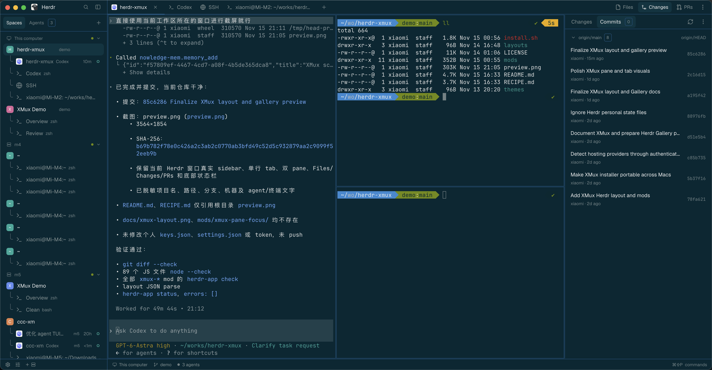

# XMux

XMux is a compact, terminal-first Herdr layout and mod set for working across
spaces, coding agents, split panes, and repository panels.



A Ghostty-inspired Herdr workspace with compact tabs, split panes, and Files,
Changes, PRs, and Issues panels.

## Features

- A single 36px tab row with horizontal scrolling and truncated titles.
- Same-space tab dragging, machine ordering, and a collapsible Spaces and
  Agents sidebar.
- `Cmd+P` opens Go to for machine-qualified spaces, tabs, and Agent tasks.
- `+` starts a terminal in the active pane's directory. Shift-click opens the
  terminal and Agent creation menu.
- A draggable quick terminal with the same live title handling as tabs.
- Files, Changes, PRs, and Issues panels with actions for adding paths and
  links to Agent chats. See [Add to chat](README.md#add-to-chat).
- One-pixel pane frames, split spacing, focus treatment, and continuous shell
  boundaries.
- A Ghostty Solarized Dark theme shared by the Herdr chrome and terminals.
- GitHub and GitLab provider detection based on the repository remote and the
  locally authenticated `gh` or `glab` CLI.

## Layout

The window has a 268px sidebar, a 36px tab row, the active tab's panes, an
optional 368px right panel, and a 28px status bar. The sidebar contains spaces,
agents, machines, and quick actions. Collapse it to a 48px icon rail. On macOS
the tab row leaves room for native traffic lights when the sidebar is collapsed
or hidden.

The layout uses `terminal_padding: [2, 2]`, one-pixel pane frames and split
spacing, a 0.5px outer gutter when the right panel is closed, and the
`ghostty-solarized-dark` theme. Panel roots keep their left rule while the
shared shell, tab, and status boundaries remain continuous.

## Included files

| Path | Purpose |
| --- | --- |
| `layouts/XMux.json` | The XMux window layout. |
| `themes/ghostty-solarized-dark.json` | Shared terminal and app theme. |
| `mods/xmux-tabs` | Tabs, scrolling, titles, and panel actions. |
| `mods/xmux-sidebar` | Window chrome, spaces, agents, machines, and quick actions. |
| `mods/xmux-quick-dialog` | Draggable local terminal title bar and controls. |
| `mods/xmux-files` | File tree and file viewer. |
| `mods/xmux-changes` | Changes, staging, commits, and diffs. |
| `mods/xmux-branch-pr` | Pull request workflow. |
| `mods/xmux-branch-issue` | Issue workflow. |
| `mods/xmux-new-menu` | Terminal and agent creation menu. |
| `mods/xmux-picker` | Go to spaces, tabs, and split Agents by name. |
| `mods/xmux-status` | Bottom status bar and XMux commands. |

Herdr supplies the remaining workspace pieces, including its built-in status
and terminal components.

## Install

```sh
git clone https://github.com/laoshu133/herdr-xmux.git ~/works/herdr-xmux
cd ~/works/herdr-xmux
./install.sh
```

The installer links the layout, theme, and XMux mods into
`~/.config/herdr-app`, backs up replaced XMux files under `retired/`, checks
the mods, adds shortcuts under `layout:XMux`, and switches the running app
to the `XMux` layout. Set `HERDR_APP_HOME` for another configuration directory
or `HERDR_BIN` if needed to locate `herdr-app`.

Keep personal `keys.json`, `settings.json`, machine connections, and runtime
state outside this repository. Mackup/iCloud can sync those files separately.

## Shortcuts

Use `Shift+Cmd+Arrow` to move between split panes, `Ctrl+Cmd+←/→` to switch
sidebar views, and `Ctrl+Cmd+↑/↓` to cycle through tabs or Agents. `Ctrl+Cmd+J`
visits Agents needing attention before unread completed Agents. See
[Navigation and shortcuts](README.md#navigation-and-shortcuts).

To bind `` Cmd+` `` to the quick terminal and configure `Cmd+B`, `Cmd+W`, and
other macOS shortcuts, see [Optional macOS configuration](README.md#optional-macos-configuration).

## Provider setup

The PR and Issue mods inspect the repository remote and use the locally
authenticated `gh` or `glab` CLI for that host. For hosted or self-managed
accounts, cache lifetimes, and PR host overrides, see
[Hosting CLI setup and caches](README.md#hosting-cli-setup-and-caches).

## Local verification

```sh
python3 -m json.tool layouts/XMux.json >/dev/null
node scripts/sync-common.mjs --check
node --test tests/*.test.mjs
find mods -path '*/xmux-*/*.js' -type f -print0 | xargs -0 -n1 node --check
for mod in mods/xmux-*; do herdr-app check "$mod"; done
herdr-app do layout.switch '{"name":"XMux"}'
herdr-app status
```

The tab row stays on one line with horizontal scrolling, long titles truncate,
the panel actions open their expected views, and `+` starts a terminal in the
active pane's directory.
